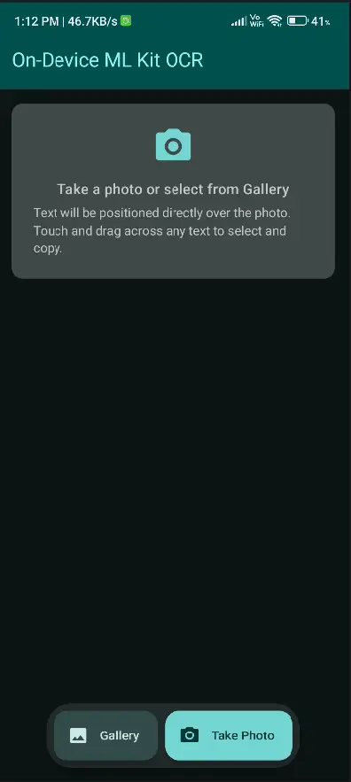
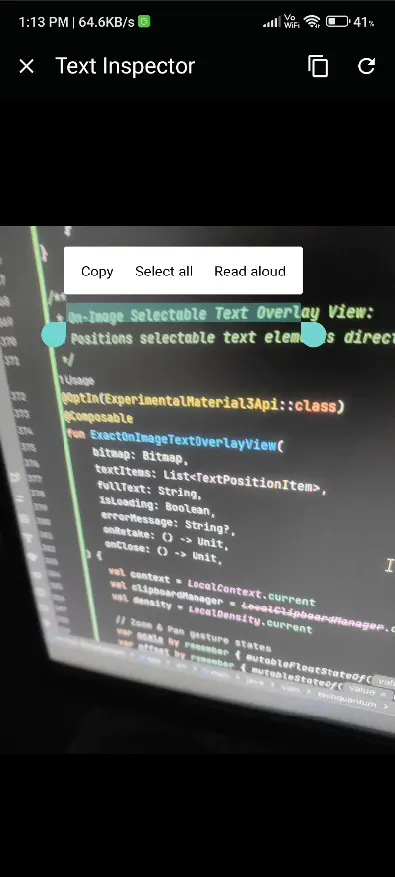
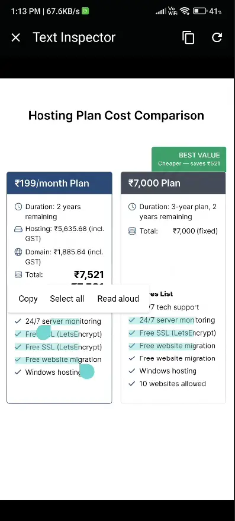

# AI-First Development: Google Lens-Style On-Device Text Recognition (OCR)

An Android application demonstrating **On-Device Artificial Intelligence** using **Google ML Kit Text Recognition**, **CameraX**, and **Jetpack Compose (Material 3)**. Inspired by Google Lens, it captures photos or picks gallery images and positions selectable text directly over the image at exact physical coordinates with full pinch-to-zoom & pan support.

---

## 📱 Screenshots & App Showcase (Parent-Child Hierarchy)

```text
📱 App Main Entry Point (Home Dashboard)
 │
 ├── 📸 Child Mode 1: Fast In-App CameraX Capture (Zero System Confirmation)
 │
 └── 🖼️ Child Mode 2: On-Image Text Inspector (Exact Coordinates & Pinch-to-Zoom)
```

### 1. 🏠 Parent Surface: Main Home Dashboard
> **Central Entry Point**: Built with Material 3 floating action bar containing `Take Photo` and `Gallery` controls.

<p align="center">
  
</p>

---

### 2. 🌿 Child Features & Extraction Modes

| 📸 Child Feature 1: Fast In-App CameraX | 🖼️ Child Feature 2: On-Image Text Inspector |
| :---: | :---: |
|  |  |
| **Key Capabilities**:<br>• **Zero System Confirmation**: Eliminates external system camera app prompts (`X` / `✓`).<br>• **Minimal Latency**: In-memory `ImageProxy` capture.<br>• **0% Idle Battery Drain**: Unbinds camera sensor immediately after capture. | **Key Capabilities**:<br>• **Exact Coordinate Overlay**: Selectable text positioned at `(X, Y, W, H)` on photo.<br>• **Direct Touch & Drag**: Touch and drag over photo text to select & copy.<br>• **Pinch-to-Zoom (1x to 5x)**: Text selection overlays move in sync with photo zoom & pan. |

---

## 🌟 Highlights & Key Features

- **100% On-Device & Offline**: Processes images locally on the device hardware (CPU/GPU/NPU). No network latency, no cloud API costs, zero data sent to external servers.
- **Exact On-Image Selectable Text**: Detected text lines are positioned at their exact physical coordinates $(X, Y, W, H)$ directly over the photo. Touch and drag across any text on the photo to select and copy.
- **Pinch-To-Zoom & Pan Synchronization**: Full gesture support for 1x to 5x pinch-to-zoom and dragging around. Text selection overlays remain 100% aligned with the zoomed photo in real time. Double-tap to reset.
- **Zero Confirmation CameraX Capture**: Custom in-app camera using `ImageCapture.CAPTURE_MODE_MINIMIZE_LATENCY`. Eliminates the system camera app's confirmation screen (`X` / `✓`).
- **Battery-Saving Lifecycle Management**: Unbinds the camera hardware sensor immediately after capture so idle battery usage and CPU/GPU load drop to 0% while inspecting photos.
- **Automatic Sensor Orientation Correction**: Applies image rotation matrix (`Matrix().postRotate(rotationDegrees)`) to display photo bitmaps at their exact upright visual angle.
- **Privacy-First**: Photos and scanned text stay strictly on the user's device.
- **Modern Photo Picker Integration**: Uses `ActivityResultContracts.PickVisualMedia` with zero storage permissions required.

---

## 🏗️ Architecture & Data Flow

```text
       [Take Photo (CameraX)  OR  Select Image (Photo Picker)]
                                │
                                ▼
         [Rotate Bitmap to Upright Sensor Orientation]
                                │
                                ▼
           [InputImage.fromBitmap(bitmap, 0)]
                                │
                                ▼
  [TextRecognition.getClient().process(inputImage)]  ──► On-Device ML Model
                                │
                                ▼
               [Extract VisionText & Bounding Boxes]
                                │
                                ▼
[Overlay Selectable Text at Exact Image Coordinates (X, Y, W, H)]
                                │
  ├──► Touch & Drag over image words to Select / Copy
  ├──► Pinch-to-Zoom (1x to 5x) & Pan photo with gestures
  └──► One-Tap Copy All / Retake Action Toolbar
```

---

## 🛠️ Tech Stack & Dependencies

- **Language**: Kotlin
- **UI Framework**: Jetpack Compose with Material 3
- **Camera Stream**: CameraX (`androidx.camera:camera-core`, `camera-camera2`, `camera-lifecycle`, `camera-view`)
- **Machine Learning**: [Google ML Kit Text Recognition](https://developers.google.com/ml-kit/vision/text-recognition/v2/android) (`com.google.android.gms:play-services-mlkit-text-recognition`)
- **Image Loading**: [Coil](https://coil-kt.github.io/coil/) (`io.coil-kt:coil-compose`)

### `app/build.gradle.kts`
```kotlin
dependencies {
    // Jetpack Compose & Material 3
    implementation(platform(libs.androidx.compose.bom))
    implementation(libs.androidx.compose.material3)
    implementation(libs.androidx.compose.material.icons.extended)

    // ML Kit Text Recognition (Play Services unbundled version)
    implementation(libs.play.services.mlkit.text.recognition)

    // CameraX for in-app capture
    implementation(libs.androidx.camera.core)
    implementation(libs.androidx.camera.camera2)
    implementation(libs.androidx.camera.lifecycle)
    implementation(libs.androidx.camera.view)

    // Image loading for Compose
    implementation(libs.coil.compose)
}
```

### `AndroidManifest.xml` Permissions
```xml
<manifest xmlns:android="http://schemas.android.com/apk/res/android">

    <uses-permission android:name="android.permission.CAMERA" />
    <uses-feature android:name="android.hardware.camera.any" />

    <application ...>
        <meta-data
            android:name="com.google.mlkit.vision.DEPENDENCIES"
            android:value="ocr" />
    </application>
</manifest>
```

---

## 🔍 On-Device vs Cloud OCR

| Metric | On-Device (ML Kit) | Cloud Vision API |
| :--- | :--- | :--- |
| **Internet Requirement** | **None** (Works offline) | Mandatory active connection |
| **Cost** | **Free** (Unlimited scans) | Pay-per-request / Monthly quotas |
| **Latency** | Instant (~50-150 ms) | Network roundtrip (~1-3 seconds) |
| **Privacy** | 100% on-device | Images sent to cloud servers |
| **Target Use-Case** | Printed text, documents, receipts, boards | Complex cursive scripts & dense handwriting |

---

## 🚀 Getting Started

1. Clone or open the repository in **Android Studio (Ladybug / 2024.2.1+)**.
2. Sync the project with Gradle files.
3. Run on an Android device or emulator (API 23+).
4. Tap **Take Photo** to launch the in-app camera or **Gallery** to select an existing photo.
5. Touch and drag across any text directly on the photo to select and copy text instantly.
